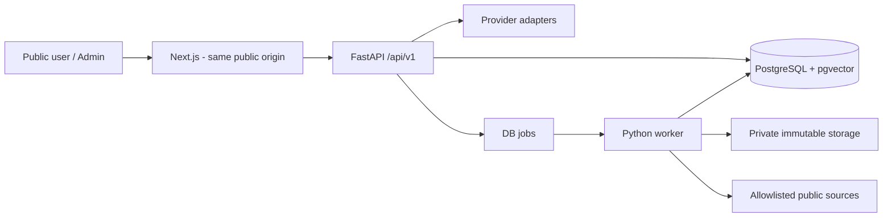

# AGU Admission Assistant — System Architecture

| Thuộc tính | Giá trị |
|---|---|
| Phiên bản | 0.9 — Baseline Candidate |
| Ngày | 2026-11-08 |
| Kiến trúc được chọn | Modular monolith + worker bất đồng bộ |
| Approval / validation | Theo [00](00-baseline-decisions.md); chưa triển khai/benchmark |

## 1. Drivers và deployment

Correctness, traceability, isolation và khả năng vận hành của một developer là ưu tiên. Stack tại [ADR-001](decisions/ADR-001-technology-stack.md). P0 gồm một web app Next.js, một FastAPI app, một worker Python, managed PostgreSQL/pgvector và private object storage. API/worker dùng chung domain code, tách process; không microservices/Redis/Kubernetes ngay từ đầu.



Browser gọi /api cùng origin qua reverse proxy; không tạo business logic thứ hai trong Next.js. Backend là nơi kiểm tra quyền và policy. Nguồn AGU là website công khai, không phải integration được trường bảo đảm. Parser sandbox không tự fetch liên kết/tài nguyên nhúng; crawler riêng thực hiện kiểm tra URL.

## 2. Modules và boundaries

| Module | Sở hữu | Ranh giới |
|---|---|---|
| conversation | Anonymous session/context/cancel/feedback | Không coi assistant text cũ là evidence |
| query_router | Intent/entities/year/applicability | Không arbitrary SQL, không tự chọn unknown scope |
| retrieval | Dense/lexical/RRF, optional rerank | Mọi nhánh/expansion qua eligibility filter |
| admission_facts | Typed facts, aliases, rule cards P0 | Parameterized whitelisted accessors |
| answering | Claims, support checks, rendering | Không phát raw tokens hoặc raw model URLs |
| content | Review, conflicts, candidate/releases/overrides | Chỉ người có role duyệt/activate/revoke |
| ingestion | Download/IR/QA/chunk/embed | Không tự duyệt/publish |
| evaluation | Dev/holdout/rubric/reports | Không lấy output model làm ground truth duy nhất |
| identity | OIDC/admin sessions/RBAC/audit | Roles từ server; MFA bắt buộc trước pilot |
| operations | Usage/reservations/freshness/alerts | Không raw sensitive payload trong telemetry |

Presentation → application → domain → infrastructure. Interfaces tại provider/storage/repository boundary; domain không import LlamaIndex/SDK hoặc tự tạo nhiều abstraction không có use case.

## 3. Serving bundle và request consistency

Serving bundle bất biến gồm knowledge_release_id, index_version_id, runtime_config_id và checksum manifest. Index version khóa query/document embedding model/dimension/normalization; runtime config khóa router/prompt/generator/verifier/retrieval params và limits. Facts/rule cards/eligible units thuộc knowledge release. Xem schema tại [05](05-data-architecture.md).

Một active_bundle_id được đổi trong transaction sau candidate QA/eval/approval. Request pin bundle và policy_epoch tại đầu; không đọc active pointer lại để trộn cấu hình giữa các bước.

Global safety overrides và current-use exclusions độc lập với bundle; rollback không xóa chúng. Safety journal độc lập DB và restore control tại 05 bảo vệ các thay đổi mới hơn backup. Trước khi phát answer, backend làm final eligibility commit trong DB: kiểm tra epoch, affected units/facts, reference date/effective cutover, freshness, policy sync và quyền truy cập. Nếu policy hoặc applicability đổi trong lúc xử lý, hủy kết quả với service_unavailable/knowledge_changed; không tự generation lại trong P0.

Final eligibility commit là điểm tuyến tính hóa phát hành câu trả lời: thu hồi commit trước điểm này chặn đáp án; sau điểm này nội dung có thể đã trên đường truyền. Không hứa thu hồi được bytes người dùng đã nhận. Request mới sau revoke không được dùng nguồn bị chặn. P0 tắt full-answer cache và retrieval cache; thêm cache sau khi có invalidation/epoch tests.

Rollback: activate một bundle cũ chỉ sau compatibility/current-policy checks và targeted critical eval. Nếu bundle cũ thiếu nguồn thay thế, affected query phải abstain; không phục hồi giá trị cũ cho current use. Có thể cần build bundle dùng runtime/index cũ nhưng knowledge mới. Revocation khẩn cấp không cần chờ eval; việc mở lại nguồn cần review/release mới.

## 4. API contracts

Prefix /api/v1. Errors: code, message, request_id, retry_after_seconds?; không stack trace/secrets. Public sessions dùng opaque HttpOnly credential, conversation_id chỉ là ID. Mọi endpoint session/cancel/feedback kiểm tra binding credential. CSRF/Origin checks cho mutations; public và admin cookie tách riêng.

| Endpoint | Auth | Contract |
|---|---|---|
| POST /chat | Anonymous session + throttle | message, conversation_id?, academic_year? → buffered validated response |
| POST /chat/stream | Như trên | Fetch-based SSE; progress rồi complete answer |
| POST /chat/requests/{id}/cancel | Request owner | Best-effort cancellation; không hoàn trả chi phí đã phát sinh |
| DELETE /conversation | Session owner | Xóa context, rotate credential |
| POST /feedback | Session owner | request_id, rating, reason_code; không free text |
| GET /public/years | Public | Coverage/year labels, last_checked_at; không khẳng định mọi chủ đề năm đó đều đủ |
| GET /public/documents/{version_id} | Public | Safe citation metadata; không expose private object path |
| GET /public/majors | Public, P1 | Verified records theo năm |
| POST /admin/sources | Admin | URL/upload, trả 202 + job_id |
| GET /admin/ingestion-jobs/{id} | Admin/reviewer | stage, attempts, warnings, retryability |
| POST /admin/revisions/{id}/approve | Reviewer | Unit/fact review audit; không activate |
| POST /admin/releases | Publisher | Build candidate manifest + index/config refs |
| POST /admin/evaluations/runs | Reviewer/publisher | Candidate + dataset + runtime refs |
| POST /admin/releases/{id}/approve | Reviewer | QA/eval evidence, stale/conflict review |
| POST /admin/bundles/{id}/activate | Publisher | Approved/eval-passed compatible bundle, atomic pointer |
| POST /admin/overrides | Publisher/admin | Revoke/current-use block with scope/reason, epoch increment |
| POST /admin/bundles/{id}/rollback | Publisher/admin | Current-policy/compatibility checks, audit reason |
| GET /health/live, /health/ready | Infrastructure | Liveness/readiness, không lộ dependency credentials |

Illustrative response; example.invalid và UUID bên dưới chỉ là synthetic schema, không dữ liệu AGU:

```json
{
  "request_id": "req_example",
  "conversation_id": "conv_example",
  "status": "answered",
  "reason_code": null,
  "context": {"academic_year": 2026, "admission_round": null, "historical": true, "reference_date": "2026-11-08"},
  "claims": [{"claim_id": "c1", "kind": "narrative", "text": "Trích đoạn minh họa, không phải quy định AGU.", "evidence_ids": ["ev1"]}],
  "citations": [{"evidence_id": "ev1", "document_version_id": "00000000-0000-4000-8000-000000000001", "source_revision_id": "00000000-0000-4000-8000-000000000002", "title": "SYNTHETIC fixture", "source_url": "https://example.invalid/source.pdf", "page": 1, "retrieved_at": "2026-11-08T00:00:00Z", "source_change_status": "not_checked"}],
  "knowledge_release_id": "release_example",
  "last_checked_at": "2026-11-08T00:00:00Z"
}
```

Backend sở hữu claim kind/fact rendering và citation registry; không tin nhãn kind do LLM tự gán. source_change_status dùng unchanged_at_last_check/changed/not_checked, không coi chưa kiểm tra là không thay đổi. Non-answered response có claims rỗng, message template/reason_code và official links; conflict có thể kèm nguồn mâu thuẫn dưới dạng references, không khẳng định một giá trị đúng.

Domain states: answered | clarification_needed | insufficient_evidence | conflicting_sources | out_of_scope | service_unavailable. HTTP 400/413 cho validation/size, 401/403 cho quyền, 429 cho throttle, 503 cho dependency failure ở nonstreaming. Domain missing/conflict không bị coi là 500.

### SSE P0

started(request_id) → progress(stage được whitelist: retrieving/validating) → answer(toàn bộ response đã kiểm tra) → completed. Không có delta event. answer là kết quả nghiệp vụ hoàn chỉnh; completed chỉ đóng transport. Nếu mất kết nối sau khi đã nhận đủ answer event, UI giữ đáp án hợp lệ; nếu trước đó thì không giả hoàn tất. Lỗi sau khi mở stream dùng error(code, safe message), đóng stream, không completed giả. Cancel trước answer không phát answer; browser giữ input và đánh dấu đã dừng. Disconnect hủy best effort; giữ usage reservation cho call có thể vẫn bị provider tính phí. Không retry generation tự động do reconnect. Nonstreaming và SSE dùng cùng answer service/validation.

## 5. Security và provider boundary

- Admin: managed OIDC, allowlisted subjects, MFA, secure HttpOnly session, RBAC admin/reviewer/publisher tại API. Một account mang nhiều role được, actor/audit vẫn riêng từng hành động. Không tự xây password/reset system.
- Input: max 2.000 ký tự/message, context tối thiểu theo 05; reject oversize trước provider. Chặn/loại định danh nhạy cảm theo policy, không hứa heuristic tìm được mọi PII.
- Upload chỉ admin: PDF/DOCX/HTML allowlist, magic bytes/MIME, 20 MB và 50 trang/file làm defaults có cấu hình; quarantine khi vượt/không parse được. Parser giới hạn CPU/RAM/time, không macro/external entities/network tùy ý.
- URL fetch: HTTPS, domain/path allowlist, kiểm tra DNS/private IP/redirect ở mỗi hop, timeout/size caps; không chỉ kiểm tra chuỗi URL ban đầu. Remote source content chỉ là data.
- Model: không privileged tools, arbitrary SQL hoặc secret trong prompt. Sanitize output/links, disable raw SDK payload logging; provider/data-region terms qua G3.
- Secrets server/worker only; dependencies/runtime lockfiles và security updates có chủ đích. Separate local/staging/production DB/storage/credentials.

## 6. Jobs, budget và reliability

DB queue claim bằng khóa hàng/SKIP LOCKED trong transaction ngắn, commit trước OCR/network. Lease/heartbeat/fencing token ngăn worker cũ commit sau reclaim; checkpoint theo stage, max attempts 3, backoff + jitter. Defaults lease 60 giây/heartbeat 20 giây; worker tự gia hạn cho parsing dài, không giữ DB lock suốt job. Xem 05.

Atomic cost reservation trước mọi call trả phí (query embedding, generation, verifier, batch embedding). Model price catalog/version và max token limits phải biết; thiếu config/budget thì fail closed. Hết budget dùng service_unavailable/budget_exhausted. Reconcile usage sau call; unknown billing giữ reservation bảo thủ để audit. App cap kiểm soát theo catalog/usage biết được, cần đối soát hóa đơn; không coi alarm là bảo đảm hóa đơn vendor tuyệt đối.

Pilot envelope, latency và budget defaults tại 00. Throttle ban đầu: 10 requests/phút/IP, 30 requests/giờ/session; max 5 AI requests đồng thời; trả 429/Retry-After hoặc 503 capacity_exhausted, không queue vô hạn. Rate limit key là pseudonym ngắn hạn, không IP raw trong app DB. Generation không auto retry; download/embedding retry chỉ với idempotency và quota accounting. DB/eligibility guard unavailable → fail closed.

## 7. Observability, deployment và recovery

Trace: request/job ID, bundle/index/runtime/dataset/policy epoch, evidence/fact IDs, stage latency, status/reason, token/estimated cost; không raw prompt/transcript. Chỉ tái lập config và evidence khi không lưu prompt. Dashboard tối thiểu: error/timeout, validated latency, AI success, stale topics, budget/reservations, job backlog.

Alerts: sustained errors, stale/critical issue, budget 80%/100%, failed worker leases, backup/restore failure. Content operator/maintainer cùng người được trong pilot; không giả định có trực 24/7.

CI/deploy: compatible migrations một release job → API/worker deploy → staging smoke → candidate eval → promote bundle. Frontend/API đều hỗ trợ contract hiện hành trong rollout. Backup DB/object/config; safety journal/incident records độc lập DB được đối soát theo 05. Restore mặc định đóng public AI; RPO mục tiêu 24 giờ, RTO mục tiêu 4 giờ trong cửa sổ có người vận hành, phải diễn tập trước G4. Nếu không chứng minh được safety policy mới nhất thì giữ đóng dù vượt RTO. Không công bố SLA khi chưa đo.

## 8. Cơ sở và tài liệu liên quan

Worker nặng tách process phù hợp phân biệt tác vụ nhỏ/heavy computation trong [FastAPI docs](https://fastapi.tiangolo.com/tutorial/background-tasks/#caveat). DB queue là lựa chọn thiết kế, phải thử recovery; [PostgreSQL SELECT](https://www.postgresql.org/docs/current/sql-select.html) mô tả row locks/SKIP LOCKED cho queue-like access. Dùng thư viện auth được duy trì theo [Next.js authentication guidance](https://nextjs.org/docs/app/guides/authentication), và luôn authorize tại data/API boundary.

[04 AI/evaluation](04-ai-rag-architecture.md) · [05 data/privacy/operations](05-data-architecture.md) · [07 engineering](07-engineering-standards.md) · [08 roadmap](08-implementation-roadmap.md).
