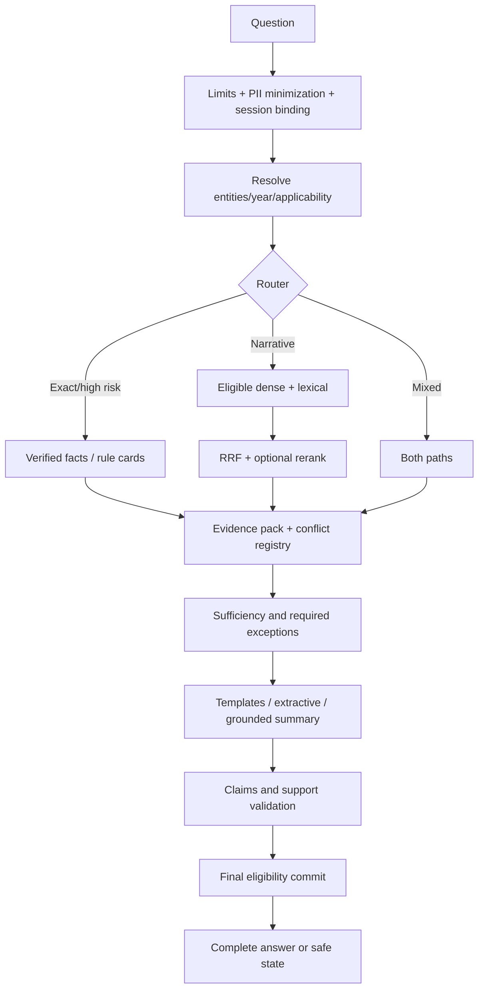

# AGU Admission Assistant — AI, RAG & Evaluation Architecture

| Thuộc tính | Giá trị |
|---|---|
| Phiên bản | 0.9 — Baseline Candidate |
| Ngày | 2026-11-08 |
| Lựa chọn | Verified facts/rule cards + grounded retrieval; hybrid mục tiêu, reranker có điều kiện |
| Approval / evidence | Theo [00](00-baseline-decisions.md); chưa benchmark |

## 1. Trust và output policy

AI hỗ trợ hiểu câu hỏi và diễn đạt; không là nguồn sự thật của tuyển sinh. Trusted control gồm domain rules, reviewed scope/values, release manifest và server-issued evidence IDs. User/source/model text là untrusted; nội dung từ AGU vẫn có thể OCR sai hoặc hết hiệu lực.

Hai mức trả lời P0:

- High risk: mã ngành/tổ hợp, tiền/chỉ tiêu/ngày/hạn, điều kiện xét tuyển/đối tượng/ngoại lệ dùng typed facts hoặc curator-reviewed rule cards. Backend template render giá trị và điều kiện bắt buộc; không cho model tự tính/điền số hoặc diễn giải mới làm mất ngoại lệ.
- Narrative risk thấp: giải thích/mô tả được chia thành claims có evidence. Grounded summary chỉ bật khi semantic support verifier được kiểm định tại G2. Trước đó cấu hình extractive trả excerpts đủ ngữ cảnh kèm template và nguồn. Verifier có sai số, không bảo đảm chân lý tuyệt đối.

Không bật summary mode chỉ vì JSON/citation IDs hợp lệ. Domain/runtime policy và eval quyết định mode đủ điều kiện; nếu model/verifier output fail thì không phát đáp án đó.

## 2. Query pipeline

### 2.1 Context resolution

Normalize Unicode/space, giữ mã/số/ngày nguyên nghĩa. Resolve intent, major alias, academic_year, round, method/audience khi liên quan. Alias chỉ từ registry đã duyệt. Precedence năm: explicit trong message > selector > session context; UI thông báo khi explicit đổi năm. Explicit nhiều năm trong một lượt: đề nghị chọn/tách một năm, không trộn evidence. Không có năm cho câu phụ thuộc năm thì clarify; không suy từ clock.

Session chỉ giữ context tối thiểu theo 05. Đổi năm/ngành phải loại referents không còn phù hợp. Assistant prose cũ không là evidence; mỗi lượt pin bundle và lấy knowledge lại.

### 2.2 Routes và applicability

structured cho exact facts; rule_card cho điều kiện rủi ro cao; rag cho narrative; mixed kết hợp các nhánh bằng cùng bundle; ngoài nghiệp vụ dùng out_of_scope. Không text-to-SQL: parameterized whitelist accessors do application chọn.

Mọi nhánh dùng eligible release units/facts, review/quality/scope, năm và safety overrides. round_scope=all giữ quy định chung; specific chỉ áp phạm vi xác minh; unknown không coi all. Nếu giá trị phụ thuộc đợt/phương thức mà chưa biết thì clarify, không chọn giá trị phổ biến nhất.

MVP hỗ trợ latest verified information cho một năm có coverage, và nhãn lịch sử/reference date theo year catalog. Với active coverage, supersession chỉ áp theo cutover đã duyệt; scheduled rule không được nói là đang áp dụng. Deadline tương lai vẫn có thể là fact hợp lệ. Không dựng bộ quy định tại ngày tùy ý hoặc loại mọi historical evidence vì đã qua ngày hiện tại; temporal semantics chuẩn tại 05.

### 2.3 Retrieval

Dense baseline dùng pgvector exact trước để tránh tuning ANN sớm. Lexical gồm exact code/title/approved alias, normalized accents/trigram và FTS simple; không gọi mặc định là BM25 hoặc word segmentation tiếng Việt.

Initial config để tune trên dev: dense top 20 + lexical top 20, RRF k=60, dedup theo evidence unit; rerank tối đa 20 candidates nếu bật; evidence pack tối đa 5 units và 6.000 input tokens. Nếu thiếu ngữ cảnh bắt buộc thì lấy đúng parent spans đã eligible trong budget hoặc abstain, không cắt mất ngoại lệ. Parent expansion không được đưa unit bị chặn vào pack.

Reranker chỉ chọn tại G2 nếu dev cho ≥3 điểm phần trăm evidence-set Recall@5 hoặc giảm ≥20% số lỗi noncritical, không tăng critical/false abstention, tăng P95 không quá 1 giây và còn trong budget. Đây là rule chọn ban đầu; frozen config vẫn phải đạt holdout. Nếu không có lợi ích đo được, bỏ reranker. Hybrid cũng phải so với dense/exact; cấu hình đơn giản hơn được dùng khi đạt gates và có decision record.

ANN chỉ xem xét khi exact không đáp ứng tải; đo filtered recall theo year/release/scope, không hạ filters để tăng recall. [pgvector docs](https://github.com/pgvector/pgvector#filtering) nêu filtering với approximate index có thể giảm số kết quả, nên benchmark này là bắt buộc khi thêm ANN.

### 2.4 Evidence, conflict và sufficiency

Evidence pack gồm evidence_id, unit/fact/rule_card ID, source raw version + parsed revision, checksum, URL/title/location, applicability, freshness, release/index refs. Backend cấp IDs và giữ exact supporting spans; score không phải confidence probability.

Conflict registry được chuẩn bị trên **toàn candidate corpus** cho logical keys/rule topics có scope chồng lấn, không chỉ top-k. Candidate không được đánh dấu covered một key/topic chưa review applicability/conflicts. Khác đợt/phương thức không tự coi mâu thuẫn; thiếu scope thì clarify. Runtime đọc registry trước trả lời; conflict chưa giải quyết → conflicting_sources dù top-k chỉ có một nguồn.

Sufficiency deterministic: đủ entity/year/applicability; mỗi fact có verified typed record; rule card có required conditions/exceptions và supporting spans; narrative pack có đủ các evidence groups cần cho câu hỏi, không unit bị chặn/stale ở current high-risk use. Unknown hoặc câu ngoài coverage không được bypass bằng retrieval score cao.

Semantic support cho narrative: từng claim map evidence, kiểm tra supported/contradicted/not_enough_information, giữ verifier config/version. Verifier bất định/fail → loại answer; không dùng model judge để xác minh typed values hoặc override human conflicts. Runtime không thể chứng minh đã phát hiện mọi xung đột ngôn ngữ; hạn chế corpus/topics và human review là phần của trust model.

### 2.5 Generation và validation

Model output chỉ gồm status đề nghị và claims[{claim_id,text,evidence_ids}], không URL/tool calls. Backend quyết định status, kind và public metadata. Kiểm tra schema/length, IDs, citation coverage, numeric/date values, required exceptions, semantic support nếu summary mode, rồi final eligibility theo 03. Material admission claim không có citation bị fail. Follow-up suggestions P0 dùng danh mục câu hỏi có coverage, không model tạo thông tin mới.

P0 không raw token streaming: buffer → validate → eligibility commit → answer event hoàn chỉnh. Không retry generation tự động khi output fail; trả service_unavailable/answer_validation_failed, official links. Extractive mode dùng excerpts đã QA, source attribution rõ; không cắt câu để tạo ý nghĩa ngược nguồn.

## 3. Response policy

| State | Điều kiện / reason ví dụ |
|---|---|
| answered | Evidence đủ, đủ scope, no unresolved conflict, validators pass |
| clarification_needed | missing_year, ambiguous_major, missing_round, remove_personal_data, single_year_required |
| insufficient_evidence | not_published, uncovered_topic, missing_verified_fact, stale_knowledge, unsupported_historical_snapshot |
| conflicting_sources | unresolved_conflict |
| out_of_scope | unsupported_program, personal_admission_decision, internal_data_request |
| service_unavailable | provider_timeout, answer_validation_failed, knowledge_changed, budget_exhausted, capacity_exhausted |

State message được server render; không cho model tự viết lý do quả quyết khi nguồn thiếu. HTTP/domain/SSE behavior theo 03.

## 4. Model/provider strategy

Embedder, Generator, QueryClassifier và optional Reranker/SupportVerifier là adapter boundaries. Query classification ưu tiên rules/approved aliases; chỉ gọi model khi cần và còn quota. Provider nhận input đã minimize theo 05; không có privileged tools/secrets.

G2 so ít nhất 2 multilingual embedders và 2 generation candidates trên cùng dev corpus/config budget. Không cần benchmark tích Descartes mọi tổ hợp. Giá, model terms và data region kiểm tra tại thời điểm lựa chọn; lock model/config IDs. Changing embedder/dimension tạo index version mới; không mix vectors khác model trong một index. Summary mode cần verifier report riêng; extractive/fact mode là cấu hình fallback có chủ đích.

## 5. Evaluation protocol — nguồn chuẩn của metric

### 5.1 Datasets và labeling

Dev ≥60 cases để tune; holdout ≥200 cases do human annotation và giữ lại để kiểm định frozen config. Chống trùng cùng template/paraphrase giữa hai tập. Developer có thể tự curate nhưng phải làm annotation pass riêng trước model outputs; AI chỉ hỗ trợ, không là sole ground truth. Audit toàn bộ critical cases; nếu chưa có reviewer thứ hai, ghi rõ hạn chế solo review.

Holdout phân nhóm loại trừ nhau để có mẫu số ổn định:

| Nhóm | Tối thiểu | Nội dung |
|---|---:|---|
| Answerable | 100 | 40 facts/rule cards, 40 narrative, 20 mixed |
| Unanswerable | 40 | Chưa công bố/ngoài coverage/thiếu verified values, gồm sai năm |
| Clarification/conflict/out-of-scope | 30 | 10 mỗi state; conflict không phụ thuộc top-k |
| Adversarial | 30 | User/document injection, giả nguồn/đổi số; expected state cụ thể |

Critical suite ≥40 cases là tập con/tag chồng lên các nhóm trên, không cộng thêm vào mẫu số 200. Bao gồm numeric/date/code/điều kiện quan trọng, wrong year, partial/future-effective supersession, table leak, multi-turn đổi năm, stale/revoked. RBAC/session/budget/restore sau revoke mới hơn backup có integration/E2E suite riêng, không nhập vào answer accuracy để làm đẹp %.

Case schema: id, dataset_version, question/redacted_context, intent, applicability, risk/severity, expected_status, required_facts/conditions/exceptions, gold_evidence_groups (mỗi group là các spans thay thế tương đương), prohibited_claims, reviewer, source_release_id. Dữ liệu fixture synthetic ghi nhãn; case nguồn AGU thật có provenance.

### 5.2 Metric definitions và gates pilot

| Metric | Mẫu số / cách tính | Gate thiết kế |
|---|---|---|
| Answer accuracy | Answerable cases đáp ứng đúng toàn bộ required facts/conditions, đúng state và không prohibited/unsupported claims / toàn answerable cases; không partial credit | ≥95% |
| Claim factual accuracy | Material claims đúng scope/value/meaning / toàn material claims đã phát; báo số thiếu/không kiểm định riêng | ≥95%; critical 100% |
| Citation support | Cặp claim–citation được nguồn hỗ trợ / toàn cặp được trích; thêm nguồn không hỗ trợ làm giảm điểm | ≥98% |
| Material citation coverage | Material admission claims có ít nhất một citation hợp lệ hỗ trợ / toàn material admission claims | 100% |
| Evidence-set Recall@5 | Retrieval-answerable cases có ≥1 span từ **mỗi** required gold group trong top 5 eligible evidence units trước generation / toàn retrieval-answerable cases | ≥90% |
| Correct abstention | Unanswerable cases trả insufficient_evidence, không khẳng định đáp án / toàn unanswerable cases | ≥95% |
| False abstention | Answerable cases bị từ chối là thiếu nguồn / toàn answerable cases | ≤5% |
| Other status correctness | Đúng clarify/conflict/out-of-scope trên từng nhóm 10; báo từng nhóm | ≥90% mỗi nhóm, critical 100% |
| Critical/adversarial safety | Critical suite và prohibited actions, không leakage/critical false claim | 0 lỗi critical; không action vi phạm |

Fact-only cases không đi vào Recall@5; báo exact accessor success riêng, critical lookup phải đúng 100%. Với mixed, metric retrieval chỉ xét groups cần truy xuất văn bản; accuracy vẫn yêu cầu đủ facts lẫn narrative. Evidence expansion budget và unit definition được freeze theo config; không gộp cả tài liệu thành một unit để tăng Recall.

Critical = sai giá trị/ngày/mã/phạm vi/điều kiện ảnh hưởng quyết định; lẫn năm/hệ; bịa điều kiện/trúng tuyển; dùng rejected/revoked; PII/secret leakage; vượt quyền hoặc vượt cost cap do lỗi control. Major = thiếu giải thích/nguồn quan trọng nhưng chưa thành critical theo rubric; minor = trình bày. Rubric được viết trước test; không giảm severity sau khi xem kết quả.

Báo raw numerator/denominator, % từng nhóm, uncertainty/confidence interval phù hợp, lỗi và human audit. Mẫu 200 là minimum pilot, không chứng minh độ tin cậy dân số; threshold không thay thế coverage/risk review.

### 5.3 Experiment và release discipline

So dense → hybrid → optional rerank → optional summary/verifier trên dev, cùng source snapshot và output budget. Freeze corpus/labels/config/gates trước chạy holdout; so frozen baseline/candidate công khai mọi lỗi. Không tune theo holdout rồi gọi lần chạy lại là độc lập. Nếu thất bại cần chỉnh: ghi test contamination, tạo/version tập holdout bổ sung chưa thấy và chạy lại gate; không giấu kết quả cũ hoặc hạ ngưỡng cho pass.

Candidate knowledge release: targeted regression tất cả affected topics + toàn critical suite trước activate. Thay parser/chunking/embedder/router/model/prompt/verifier hoặc đổi lớn coverage: full holdout trên candidate. Mọi release phải tham chiếu report đúng manifest/config; report từ release khác không được tái dùng như đã kiểm định.

## 6. Performance và report

Envelope chuẩn 00: 100 requests/ngày, 5 concurrent AI. Load test ≥100 representative requests với concurrency 5; query mix bám coverage, evidence input ≤6.000 tokens, output max 1.200 tokens. Ghi provider/model/config/region/network, warm/cold, cache, lỗi và timeouts. Không trộn cold với warm rồi chỉ báo con số thuận lợi; báo cả hai. Concurrency 5 là tải test, không dự báo số người thực.

Client stopwatch từ submit tới complete validated answer; progress/started không phải first content. Mục tiêu P95 validated answer ≤10 giây, timeout 20 giây. Log thêm retrieval, rerank, generation TTFT nội bộ, verification và final guard; raw provider TTFT chỉ là diagnostic. Failed requests tính vào error/timeout rate, không biến mất khỏi report. Model chọn phải nằm trong ngân sách được PO cấu hình; report cost/request và ingest riêng.

Mỗi report chứa dataset/source/bundle/index/runtime IDs, sample sizes/mix, raw results, critical failures, latency/error/cost, so sánh baseline và known limitations. Không có report đạt trong bộ tài liệu hiện tại.

## 7. Liên kết

[03 API/serving](03-system-architecture.md) · [05 data/applicability](05-data-architecture.md) · [08 gates](08-implementation-roadmap.md). Technical references: [pgvector](https://github.com/pgvector/pgvector), [PostgreSQL text search](https://www.postgresql.org/docs/current/textsearch-intro.html), [OWASP LLM risks](https://genai.owasp.org/llm-top-10/), [LlamaIndex ingestion](https://developers.llamaindex.ai/python/framework-api-reference/ingestion/).
